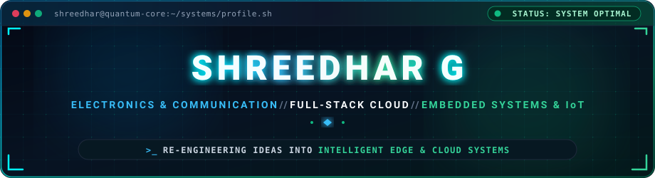
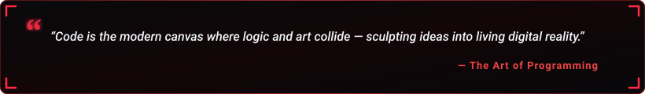

<!-- ============================================================== -->
<!-- 🚀 SHREEDHAR G // CYBER-ENGINEERING PROFILE README           -->
<!-- Theme: Electric Cyber-Cyan & Emerald Mint // Futuristic Dark   -->
<!-- ============================================================== -->

<div align="center">
  
</div>

<p align="center">
  <a href="https://github.com/shreedharg405-sketch">
    
  </a>
</p>

<!-- Quick Navigation Pill Badges -->
<p align="center">
  <a href="https://portfolio-2ov.pages.dev/" target="_blank">
    
  </a>
  &nbsp;
  <a href="https://linkedin.com/in/shreedhar-g" target="_blank">
    
  </a>
  &nbsp;
  <a href="https://portfolio-2ov.pages.dev/assets/resume.pdf" target="_blank">
    
  </a>
  &nbsp;
  <a href="mailto:shreedharg405@gmail.com">
    
  </a>
</p>

<!-- Telemetry Views Counter -->
<p align="center">
  
</p>

```yaml
# ─── [ SYSTEM SPECIFICATIONS : SHREEDHAR G ] ──────────────────────────────────────────
👤 IDENTITY       : Shreedhar G (Electronics & Communication Engineer // Developer)
📍 COORDINATES    : Chennai, Tamil Nadu, India
🏫 INSTITUTION    : Prince Shri Venkateshwara Padmavathy Engineering College (2023 — 2027)
⚡ SPECIALIZATION : Full-Stack Web Architecture • FastAPI Microservices • Embedded IoT Edge
🚀 STATUS         : Open to Software Engineering Internships & Technical Collaboration
# ──────────────────────────────────────────────────────────────────────────────────────
```

<div align="center">
  <a href="https://portfolio-2ov.pages.dev/" target="_blank">
    
  </a>
  &nbsp;
  
  &nbsp;
  
</div>

<br />

---

### ⚡ Overview & Objective

> Motivated and responsible **Electronics and Communication Engineering student & software developer** based in Chennai, India. A dedicated, adaptable, and quick learner who enjoys tackling engineering challenges, collaborative development, and continuous self-improvement. Focused on architecting responsive web applications, high-performance backends, and smart microcontroller-based IoT platforms.

<br />

---

### 🚀 Featured Engineering Projects

#### 🐔 01 // Poultry Flock Pro & Weight Tracker
> **Enterprise-Grade Farm Management & Live Flock Monitoring Platform**  
> *Stack:* `React` • `TypeScript` • `Tailwind CSS` • `Cloudflare Workers` • `Cloud Database`

* **Multi-Tier Administration:** Engineered full-stack operational tracking for farm-wise, batch-wise, and shed-wise daily flock management.
* **Automated Computation:** Automated real-time bird bodyweight computations, flock uniformity curves, and shed performance analytics.
* **Cloud Sync & Analytics:** Integrated automated cloud-based data synchronization and dynamic Excel report generation across multiple sheds.

<p>
  <a href="https://github.com/shreedharg405-sketch/poultry-weight-tracker" target="_blank">
    
  </a>
</p>

---

#### 📚 02 // Student Management System (SMS)
> **Academic Information Management & High-Speed REST Backend**  
> *Stack:* `Python` • `FastAPI` • `MySQL` • `HTML5` • `CSS3` • `JavaScript` • `RESTful API`

* **Centralized Data Hub:** Implemented a full-stack web application for student records, academic profiles, and administrative workflows.
* **REST API Architecture:** Developed structured API endpoints in **Python FastAPI** supporting high-efficiency CRUD operations and request validation.
* **Database Optimization:** Connected MySQL relational database with optimized indexing for structured data retrieval and integrity.

<p>
  <a href="https://github.com/shreedharg405-sketch/student-management-system" target="_blank">
    
  </a>
</p>

---

#### 🏆 03 // Sovereign Awards Platform
> **Responsive Global Digital Awards Portal for Crypto, Fintech & Payments**  
> *Stack:* `React` • `JavaScript` • `HTML5` • `CSS3` • `Modular UI`

* **Interactive Category Discovery:** Designed modular user interfaces showcasing nominee spotlights, event itineraries, and category details.
* **Engagement Engine:** Incorporated nomination submission pipelines, sponsorship portals, and event ticket booking interfaces.
* **Universal Accessibility:** Optimized mobile-first responsive layouts with fluid transitions across all viewport sizes.

<p>
  <a href="https://github.com/shreedharg405-sketch/sovereign-awards-website" target="_blank">
    
  </a>
</p>

---

#### ⚡ 04 // Hardware & Embedded IoT Systems

<table>
<tr>
<td width="50%" valign="top">
  <h4>🌡️ Smart Poultry Climate Control System</h4>
  <p><b>Hardware:</b> <code>Arduino Uno</code> • <code>DHT11 Sensor</code> • <code>Relay Actuators</code> • <code>Embedded C</code></p>
  <p>Microcontroller-driven environmental management system monitoring ambient shed temperature and humidity, automatically triggering heating elements and ventilation exhaust fans via multi-channel relays.</p>
</td>
<td width="50%" valign="top">
  <h4>💡 Smart Lume (Intelligent Street Light)</h4>
  <p><b>Hardware:</b> <code>ESP32</code> • <code>LDR Sensor</code> • <code>PIR Motion Sensor</code> • <code>Solar Array</code></p>
  <p>Autonomous solar-powered street lighting infrastructure using dual optical sensing (LDR ambient lux tracking + PIR human presence detection) to dynamically throttle LED power and maximize battery reserve.</p>
</td>
</tr>
</table>

<br />

---

### 🧠 Technical Arsenal & Skill Matrix

<div align="center">

<p>
  <sub><b>PROGRAMMING LANGUAGES</b></sub><br />
  <a href="https://skillicons.dev">
    
  </a>
</p>

<p>
  <sub><b>FRONTEND, BACKEND &amp; CLOUD</b></sub><br />
  <a href="https://skillicons.dev">
    
  </a>
</p>

<p>
  <sub><b>DATABASES, HARDWARE &amp; TOOLS</b></sub><br />
  <a href="https://skillicons.dev">
    
  </a>
</p>

<p>
  
  &nbsp;
  
  &nbsp;
  
  &nbsp;
  
  &nbsp;
  
</p>

</div>

<br />

---

### 💼 Industry Internship & Practical Training

<table>
<tr>
<td>
  <h3>Adventure Technology Solutions Pvt Ltd.</h3>
  <p><b>Embedded Systems Trainee / Intern</b> &nbsp;|&nbsp; <i>03 June 2025 – 03 July 2025</i></p>
  <ul>
    <li>Completed intensive practical training in <b>Embedded Systems</b>, mastering microcontroller pinouts, system registers, and hardware architecture.</li>
    <li>Engineered custom firmware in <b>Embedded C</b> for sensor polling, actuator triggers, and circuit communication buses.</li>
    <li>Acquired hands-on debugging skills in electronic component integration, timing loops, and real-time edge processing.</li>
  </ul>
</td>
</tr>
</table>

<br />

---

### 📜 Verified Credentials & Certifications

<table>
<tr>
<td width="50%" valign="top">
  <b>🎓 Diploma in Full Stack Development</b><br />
  <sub><i>I Shine Info Tech (Sep 2025 – Mar 2026)</i></sub><br />
  Comprehensive training in client-server architecture, database modeling, and scalable modern web frameworks.
</td>
<td width="50%" valign="top">
  <b>⚡ LEAP Certification (LPBO1, LPBO2 &amp; LP202)</b><br />
  <sub><i>Arduino Bootcamp &amp; Practicum for Innovative Engineering (2024)</i></sub><br />
  Practical hardware interfacing, microcontroller circuits, and prototype engineering.
</td>
</tr>
<tr>
<td width="50%" valign="top">
  <b>🛡️ QNX &amp; Reverse Engineering Certification</b><br />
  <sub><i>Hardware &amp; System Analysis (2024)</i></sub><br />
  Hardware teardown, memory architecture inspection, and system-level firmware debugging.
</td>
<td width="50%" valign="top">
  <b>🔬 Machine Learning &amp; Ethical Hacking</b><br />
  <sub><i>TECHKRITI'25, IIT Kanpur (2025)</i></sub><br />
  Hands-on technical workshops covering machine intelligence fundamentals and offensive cybersecurity principles.
</td>
</tr>
</table>

<br />

---

### 📊 GitHub Telemetry & Activity Metrics

<div align="center">
  
  &nbsp;&nbsp;
  
</div>

<br />

<div align="center">
  
</div>

<br />

<div align="center">
  
</div>

<br />

---

### 📡 Transmission Channels & Social Connect

<p align="center"><i>Whether you want to discuss full-stack cloud applications, embedded systems, or exciting career opportunities — feel free to reach out!</i></p>

<table align="center" border="0">
<tr>
<td align="center" width="200" style="padding: 12px;">
  <a href="https://www.linkedin.com/in/shreedhar-g/" target="_blank">
    
    <br /><br />
    
  </a>
  <br />
  <sub><b>Professional Network</b></sub>
</td>
<td align="center" width="200" style="padding: 12px;">
  <a href="https://portfolio-2ov.pages.dev/" target="_blank">
    
    <br /><br />
    
  </a>
  <br />
  <sub><b>Interactive Showcase</b></sub>
</td>
<td align="center" width="200" style="padding: 12px;">
  <a href="mailto:shreedharg405@gmail.com">
    
    <br /><br />
    
  </a>
  <br />
  <sub><b>shreedharg405@gmail.com</b></sub>
</td>
</tr>
</table>

<div align="center">
  
</div>
